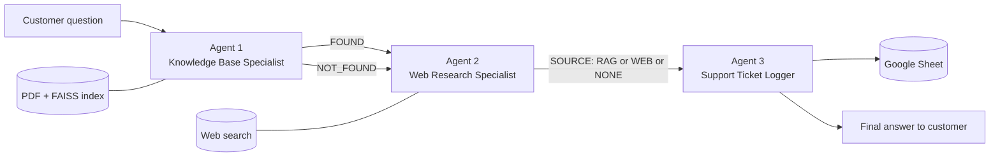

# Customer Support Agentic AI

A multi-agent customer support assistant built with [CrewAI](https://github.com/crewAIInc/crewAI). It answers questions from your own knowledge base first, falls back to the web only when the knowledge base has no answer, and logs every interaction to Google Sheets.


---

## Overview

Most support bots either hallucinate or only know what is in their documents. This project combines both: answers are grounded in your company's PDF first, and the web is used only as a fallback. Every conversation is recorded for auditing and analytics.

| Agent | Responsibility | Tool |
|---|---|---|
| **1. Knowledge Base Specialist** | Answers strictly from the company PDF (RAG). Returns `NOT_FOUND` if nothing relevant exists. | FAISS + HuggingFace embeddings |
| **2. Web Research Specialist** | Runs only when Agent 1 found nothing. Searches the web and summarises with a source link. | DuckDuckGo search |
| **3. Support Ticket Logger** | Records timestamp, customer details, question, answer source and answer. Returns the final reply. | Google Sheets (gspread) |

## Architecture



The crew runs as a sequential process. When the knowledge base already has the answer, Agent 2 passes it through without searching the web.

## Features

- **Grounded answers:** responses come from your documents, with a relevance threshold to prevent weak matches.
- **Web fallback:** unanswered questions are researched online and the source is cited.
- **Audit trail:** every question is logged with its source (`RAG`, `WEB` or `NONE`).
- **Customer capture:** name and contact details are collected with the customer's knowledge and logged with the question.
- **Local embeddings:** HuggingFace sentence-transformers run on your machine, so no embedding API costs.
- **Fast restarts:** the FAISS index is cached on disk and rebuilt automatically when the PDF changes.

## Tech Stack

- [CrewAI](https://github.com/crewAIInc/crewAI) for agent orchestration
- [FAISS](https://github.com/facebookresearch/faiss) for vector search
- [sentence-transformers](https://www.sbert.net/) for embeddings (`all-MiniLM-L6-v2` by default)
- [gspread](https://github.com/burnash/gspread) for Google Sheets logging
- [ddgs](https://pypi.org/project/ddgs/) for web search
- OpenAI `gpt-4o-mini` as the agents' LLM (configurable)

## Project Structure

```
crewai_support/
├── support_agent.py                       # Agents, tools, tasks and CLI entry point
├── skyline_properties_knowledge_base.pdf  # Sample knowledge base (fictional real estate company)
├── requirements.txt
├── .env.example                           # Environment variable template
├── .gitignore
└── README.md
```

## Getting Started

### Prerequisites

- Python 3.10 or higher
- An OpenAI API key
- A Google Cloud project with the Google Sheets API and Google Drive API enabled
- A Google Sheet to hold the logs

### 1. Clone and install

```bash
git clone https://github.com/<your-username>/<your-repo>.git
cd <your-repo>

python -m venv venv
source venv/bin/activate        # Windows: venv\Scripts\activate
pip install -r requirements.txt
```

### 2. Set up Google Sheets access

1. In [Google Cloud Console](https://console.cloud.google.com/), go to **IAM & Admin > Service Accounts** and create a service account.
2. Open the service account, go to the **Keys** tab, click **Add Key > Create new key > JSON**, and download the file.
3. Rename it to `service_account.json` and place it in the project folder.
4. Open your Google Sheet, click **Share**, paste the `client_email` from the JSON file, and give it **Editor** access.
5. Copy the sheet ID from its URL (`docs.google.com/spreadsheets/d/<SHEET_ID>/edit`).

### 3. Configure environment variables

```bash
cp .env.example .env
```

Then edit `.env`:

| Variable | Description | Default |
|---|---|---|
| `OPENAI_API_KEY` | API key for the agents' LLM | required |
| `RAG_FILE` | Path to your knowledge-base PDF | `knowledge_base.pdf` |
| `EMBED_MODEL` | HuggingFace embedding model | `sentence-transformers/all-MiniLM-L6-v2` |
| `SIMILARITY_THRESHOLD` | Minimum cosine score to count as a match | `0.35` |
| `CHAT_MODEL` | LLM used by the agents | `gpt-4o-mini` |
| `GOOGLE_SERVICE_ACCOUNT_JSON` | Path to the service account key | `service_account.json` |
| `GOOGLE_SHEET_ID` | ID of the logging sheet | required |

### 4. Run

```bash
python support_agent.py
```

The first run downloads the embedding model (about 90 MB) and builds the FAISS index.

## Usage

```
Your name: Fathima
Your phone or email: fathima@example.com

Customer: How much is the security deposit for a furnished flat?
Support: For furnished properties the security deposit is 10% of the annual rent ...
```

Each question adds a row to your Google Sheet:

| Timestamp | Customer Name | Contact | Question | Source | Answer |
|---|---|---|---|---|---|
| 2026-10-19 14:05:11 | Fathima | fathima@example.com | How much is the security deposit... | RAG | For furnished properties... |

### Use it from your own code

```python
from support_agent import ask

reply = ask("What documents do I need to rent?", "Fathima", "fathima@example.com")
print(reply)
```

This makes it easy to plug the crew into a Streamlit app, a web API or a WhatsApp or website chat integration.

## Using Your Own Knowledge Base

1. Replace the sample PDF with your own document, or point `RAG_FILE` at it.
2. Write the content as clear questions and answers or short sections. This improves retrieval.
3. Tune `SIMILARITY_THRESHOLD`:
   - Good questions falling through to the web: lower it (for example `0.25`).
   - Irrelevant questions getting knowledge-base answers: raise it (for example `0.45`).
4. For non-English documents, set `EMBED_MODEL=paraphrase-multilingual-MiniLM-L12-v2`.

## Testing the Three Paths

| Question | Expected source |
|---|---|
| "What documents do I need to rent?" | `RAG` |
| "What is the current mortgage interest rate in the UAE?" | `WEB` |
| A question with no answer anywhere | `NONE` |

## Troubleshooting

| Problem | Fix |
|---|---|
| `PermissionError` or 403 from Google Sheets | Share the sheet with the service account's `client_email` as **Editor**. |
| `You need access` page in the browser | You are signed in to a different Google account than the one that owns the sheet. |
| Cannot create a service account key | Your organization policy may block key creation. Use a personal Google Cloud project. |
| Columns look misaligned in the sheet | Clear the sheet or use a new one so the header row matches the current format. |
| Everything goes to the web | Lower `SIMILARITY_THRESHOLD` and confirm `RAG_FILE` points to the right PDF. |
| Scanned PDF returns no answers | The PDF has no text layer. Run OCR on it first. |

## Security and Privacy

- Never commit `.env` or `service_account.json`. The included `.gitignore` excludes them.
- Customer names and contact details are stored in your Google Sheet. Keep the sheet's sharing restricted and tell customers their details are saved with their question.
- Review your obligations under applicable data-protection law before using this in production.

## Known Limitations

- The decision to skip the web search is enforced by the agent's task prompt, not by code. A stricter, code-level branch can be built with CrewAI Flows.
- Answer quality depends on the quality and structure of your PDF.
- The sample knowledge base is fictional and should not be treated as legal or financial information.

## Roadmap

- [ ] CrewAI Flows for deterministic RAG to web routing
- [ ] Streamlit chat interface
- [ ] Support for multiple documents and file types
- [ ] Conversation memory across messages
- [ ] Local LLM option through Ollama
- [ ] Human-escalation agent for unanswered questions

## Contributing

Contributions are welcome. Fork the repository, create a feature branch, and open a pull request with a clear description of the change.

## License

Distributed under the MIT License. Add a `LICENSE` file to the repository root before publishing.
